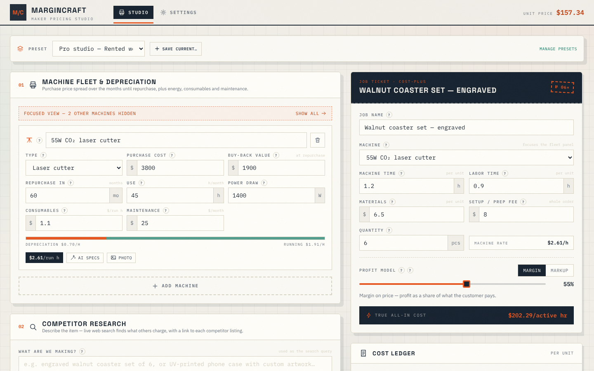
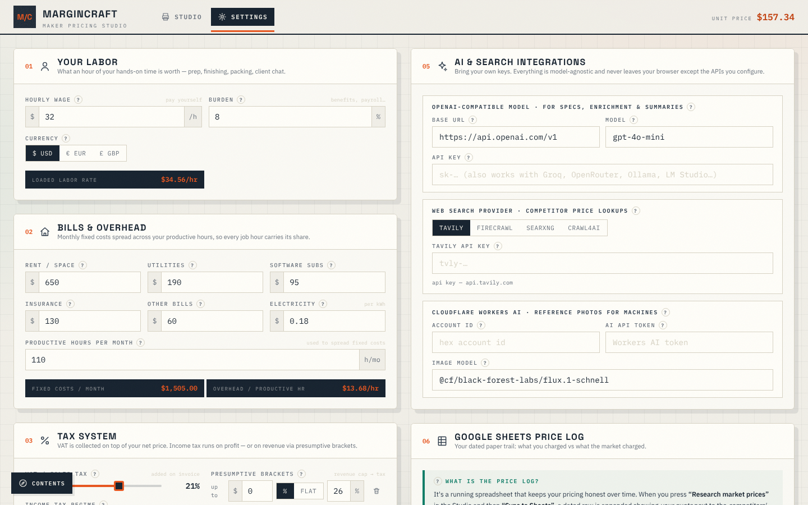
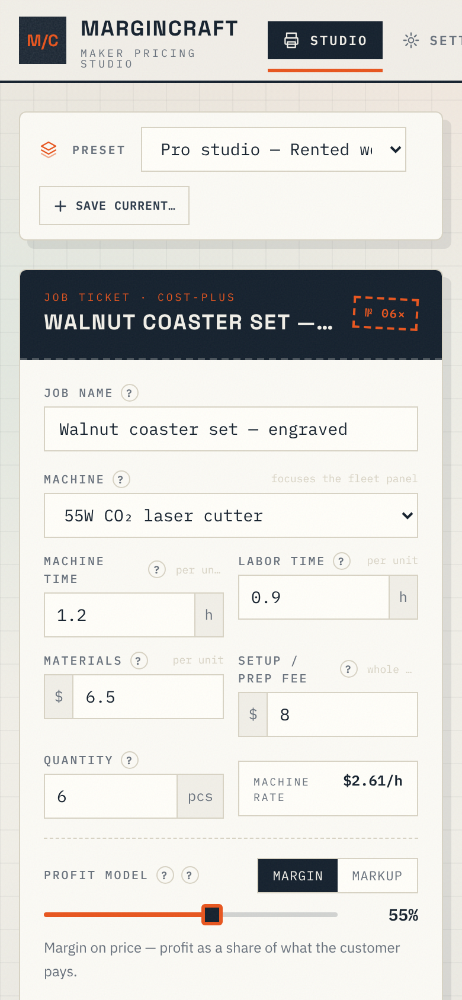

# Crafter-pricer (MarginCraft)

**Price your 3D prints, UV prints, laser and CNC jobs so every order actually pays you: machine wear, electricity, materials, your time, rent, VAT and income tax in one quote, next to what competitors charge.**

## The problem

Most makers price by gut feeling or by copying Etsy. Machine wear, the electricity bill, rent, the hour spent sanding and packing, VAT and income tax get forgotten, so many "profitable" orders lose money. Spreadsheets help until one formula breaks.

## What it does

- **True cost per unit.** Machine depreciation and running cost per hour, materials, labor at your real wage, a share of rent and bills, setup fees spread over the batch.
- **Margin or markup, your choice.** Switch between them without the price moving, or type a target price and get the percentage.
- **Taxes done right.** VAT on the invoice, income tax on profit, or presumptive (revenue-bracket) tax applied at your effective rate.
- **Market check.** Built-in price ranges for FDM, resin, UV and laser work, plus live competitor search (Tavily, Firecrawl, SearXNG or Crawl4AI).
- **Offer letters.** One click turns the quote into a Markdown offer from your own template.
- **Price log.** Each quote vs the market range goes to Google Sheets (secured with a secret) or a CSV file.
- **Presets.** Side hustle, pro studio and print-farm setups to start from; save your own.
- **Private by default.** Everything stays in your browser. Bring your own AI and search keys; nothing is sent anywhere you didn't configure.

## Quick start

- **Web:** not hosted yet (planned: Cloudflare Pages, see [DEPLOY.md](DEPLOY.md)).
- **From source:** `bun install` then `bun run dev` → http://localhost:26419

Docs site: https://docs.stravelakis.com/Crafter-pricer/ (with a live price calculator) · Full setup: [INSTALL.md](INSTALL.md) · Full manual: [GUIDE.md](GUIDE.md)

## Screenshots

| | |
| --- | --- |
|  |  |

## Status

- **Works:** everything above. 32 automated tests (pricing maths, tax, price reading), plus lint, type check and build on every PR.
- **Limits:** live competitor search needs your own search-provider key; AI machine specs and photos need your own AI / Cloudflare keys. Built-in market ranges are indicative (USD) — check them locally.
- **Next:** see [HANDOFF.md](HANDOFF.md).

## Contributing

Issues and PRs welcome. Please read the [Code of Conduct](CODE_OF_CONDUCT.md). Security problems: see [SECURITY.md](SECURITY.md).

## License

[MIT](LICENSE). Third-party credits in [NOTICE](NOTICE).
